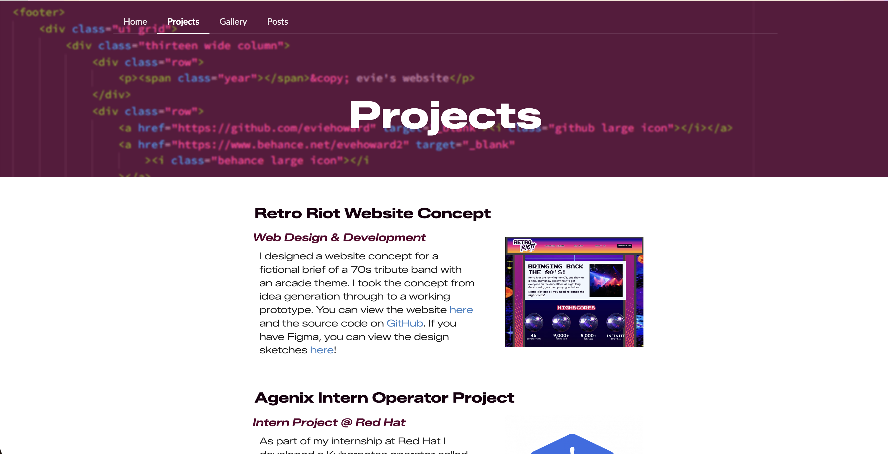

# Evie's Portfolio
[eviehoward.github.io](https://eviehoward.github.io)

This is my portfolio website, where I describe all of my projects and experience over the last few years.



## Structure
```
├── css
│   └── styles.css
├── gallery.html
├── images
├── index.html
├── js
│   └── script.js
├── posts.html
├── projects.html
└── README.md
```

## Contact

To get in touch, you can find me on [LinkedIn](https://www.linkedin.com/in/eviehoward/) or via email at [evie.howard2305@gmail.com](mailto:evie.howard2305@gmail.com).

## Resources
- Styled with Fomantic UI.
- Font is Zalando Sans Expanded from [Google Fonts](https://fonts.google.com/specimen/Zalando+Sans+Expanded?preview.script=Latn).
